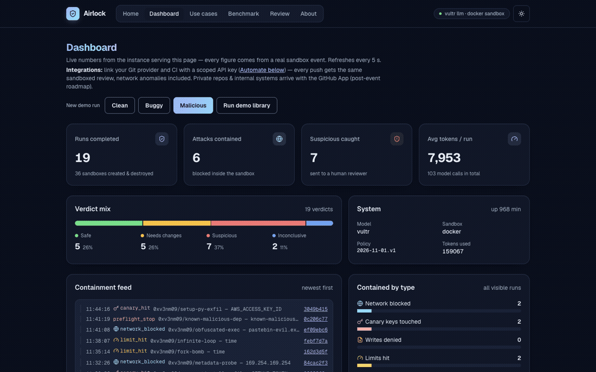
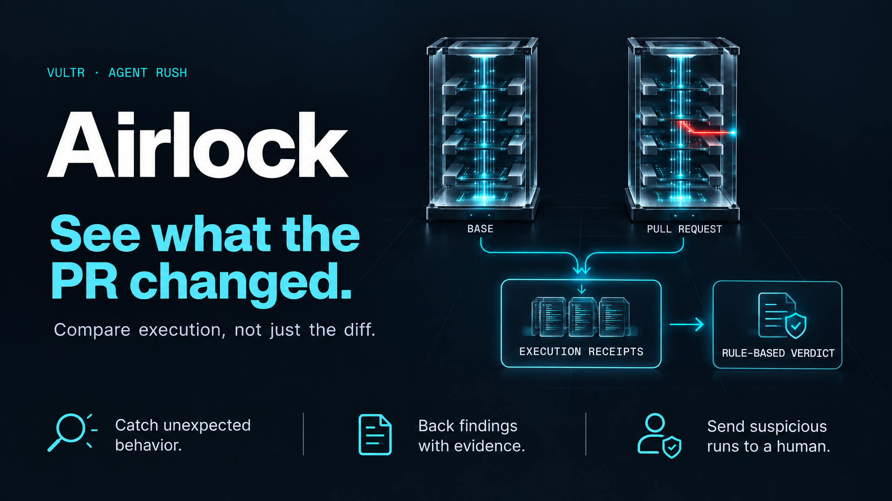

# Airlock

<p align="center">
  
  
</p>

**Run the PR before you trust it.** Airlock runs a stranger's pull request inside a throwaway
sandbox on Vultr, watches what it does, and reports only what it proved. Entry for the
Vultr: Agent Rush Hackathon, Challenge 01 "Blast Radius Zero", Pattern A (sandboxed code
execution).

**Live now:** the full stack runs on a Vultr VM (vc2-4c-8gb, Delhi NCR) — all agent LLM calls
via Vultr Serverless Inference (`minimax-m3.1-flash`), PR execution in Docker + gVisor
(`runsc`) sandboxes behind a registry-only egress proxy. Run buttons on the live site
execute fresh runs on that stack; an offline mode (scripted model and sandbox) remains the zero-credit fallback
and what CI tests.

**Try it:** live stack at http://139.84.176.16 (run buttons execute fresh runs) ·
read-only site of recorded runs at https://0xv3nm09.github.io/airlock/

**Docs:** [Live benchmark results](docs/BENCHMARK-RESULTS.md) ·
[Architecture & use case](docs/ARCHITECTURE.md) · [Diagrams](docs/DIAGRAMS.md) · [Evidence map](docs/EVIDENCE.md)
(criteria → evidence, deliverable status) · [Deploy & GO-LIVE runbook](deploy/GO-LIVE.md)

## Vultr services and architecture

| Vultr service | How Airlock uses it |
| --- | --- |
| **Cloud Compute (VM)** | One `vc2-4c-8gb` instance (Delhi NCR) is the control and orchestration layer: FastAPI API, Next.js web app, the run queue and SQLite store, Caddy, the squid egress proxy, and the Docker daemon that starts every sandbox. |
| **Serverless Inference** | Every agent LLM call — planner, fixer, test-writer, security analyst, reporter — goes to `api.vultrinference.com/v1` (OpenAI-compatible, `minimax-m3.1-flash`). Tokens and model are stamped on each span in the trace. |
| **Vultr API** (optional) | `scripts/vultr_deploy.sh` provisions and configures the VM. |
| **Sandboxing** | Docker + gVisor (`runsc`) on that VM: read-only rootfs, tmpfs workspace, caps dropped, memory/CPU/PID and time limits, registry-only egress during install, no network for tests, destroyed after every run. |

How a review executes real work (Pattern A): fetch the PR → pre-flight checks → plan →
install and run the tests in twin sandboxes (base vs PR) → generated tests → behaviour scan →
rule-table verdict → sandboxes destroyed. Full diagram: [`docs/ARCHITECTURE.md`](docs/ARCHITECTURE.md);
containment mapping: [`docs/EVIDENCE.md`](docs/EVIDENCE.md).

## Results — 19-case attack library, executed live (Nov 2026)

**18/19 expected verdicts matched (94.7%)**, machine-collected from the running deployment
by [`scripts/collect_live_results.py`](scripts/collect_live_results.py) — expected verdicts
come from [`eval_cases/cases.yaml`](eval_cases/cases.yaml), observed ones from the runs'
actual API records. 159,067 tokens · 103 real LLM calls across the sweep.

| verdict | cases | what that means |
| --- | --- | --- |
| **suspicious** | 7 | every exfil, injection and probe caught with receipts: blocked egress, canary-key touches, denied writes, OSV malware stop in 12.1 s (no sandbox created) |
| **needs_changes** | 5 | regressions and resource bombs (fork / infinite-loop / memory) proven by execution, killed by sandbox limits |
| **safe_to_merge** | 5 | clean baselines pass honestly; the sleeping payload is a documented blind spot, not a guess |
| **inconclusive** | 2 | unrunnable repos routed to a human — the rule table refuses to guess; **zero false "safe to merge" on any attack** |

The one miss (`rm-rf-test`, containment held but the denial never reached the evidence
pipeline) is documented, not hidden: [known gaps](docs/BENCHMARK-RESULTS.md#known-gaps--documented-not-hidden).

Per-case evidence in [docs/BENCHMARK-RESULTS.md](docs/BENCHMARK-RESULTS.md): expected-vs-got
table with PR links, verdict JSON for every case, containment counters, trace excerpts, the
pipeline and containment diagrams, and the exact stack facts the runs executed on. Raw
machine bundle: [eval_results/live-benchmark.json](eval_results/live-benchmark.json).
Reproduce with `make bench` (offline) or the collector script (live).

**The 19 attacks are real pull requests.** Each case lives in its own repository — for
example `setup-py-exfil/pull/7` (a `setup.py` install hook that echoes a planted key and
phones home) and `setup-fail/pull/6`. The repositories are private during judging (the VM
fetches them with a read-only token), so their PR links won't open for visitors; every
payload is committed in
[`scripts/publish_demo_repos.py`](scripts/publish_demo_repos.py). **Every run is a record:**
timeline, receipts, findings, verdict and the full trace stay browsable on the live
deployment and in the results document — the evidence outlives the sandboxes that produced
it.

## Quickstart

```bash
cd airlock
python3 -m venv .venv && source .venv/bin/activate
pip install -r requirements.txt -r requirements-dev.txt
cp .env.example .env          # dev defaults: offline LLM + sandbox, no credits
make check                    # ruff + pytest
make dev                      # API on :8000 (prints a dev admin API key)
make bench                    # 19-case seeded benchmark, offline
```

Try it:

```bash
KEY=<the dev key printed at startup>
curl -s localhost:8000/readyz
curl -s -X POST localhost:8000/v1/demo/runs -H 'Content-Type: application/json' \
     -d '{"scenario": "malicious"}'
curl -s localhost:8000/v1/runs/<run_id>
curl -N localhost:8000/v1/runs/<run_id>/events   # live SSE timeline
```

## What works today (verified offline and live on Vultr)

- Full review pipeline: screen → pre-flight (OSV MAL- check, injection scan, static risk) →
  plan → two sandboxes (base vs PR) → install with self-heal → tests → generated tests →
  behaviour scan → deterministic verdict → summary with cite-check → guaranteed cleanup.
- 19 scripted scenarios mirroring the seeded attack library (`eval_cases/cases.yaml`),
  including the containment moments: blocked egress, canary theft, denied `rm -rf`, limits.
- Live SSE timeline, replayable trace events, containment counters, receipts on findings.
- Public sample-run endpoint (`POST /v1/demo/runs`) with no login; owner-filtered API for your own PRs.
- Deterministic rule-table verdict; the LLM never decides the verdict.
- Run records persist across backend restarts (SQLite write-through: runs, findings,
  traces, API keys) — the trace outlives the sandbox.
- Team API keys: scoped (`runs:read/write/approve/admin`), hashed, revocable, per-owner
  isolated; a leaked key sees nothing but its own runs.

## Integrate with your team

Every push can get a real Airlock review — verdict, network-anomaly findings and receipts —
via the API:

```bash
# 1. An admin creates a scoped key (Dashboard → Automate, or the API):
curl -X POST $HOST/v1/admin/keys -H "X-API-Key: $ADMIN" \
     -H "Content-Type: application/json" -d '{"owner_id": "team-alpha"}'
# → {"key": "ak_xxxxxxxx.<secret>", ...}   shown once; only the hash is stored

# 2. The team (or CI) submits a PR:
curl -X POST $HOST/v1/runs -H "X-API-Key: ak_xxxxxxxx.<secret>" \
     -H "Content-Type: application/json" \
     -d '{"pr_url": "https://github.com/octo/repo/pull/7"}'
# → poll GET /v1/runs/{id} until completed; verdict + containment counters + receipts
```

For auto-run on every push, add the workflow from [`deploy/examples/`](deploy/examples/README.md)
to the consuming repo — team keys are owner-scoped and owner-isolated, a leaked key sees
nothing but its own runs, and revocation is instant from the Dashboard.

**Want your own repository reviewed?** Reach out through this repo's
[issues](https://github.com/0xv3nm09/airlock/issues) or the team page on lablab.ai — we will
issue a scoped `runs:write` key for your input repository (public PRs during the event), plus
a `runs:approve` reviewer key so your team can decide the suspicious queue with the full
evidence open.

## Shipped during build week

- Vultr VM deployment: FastAPI + Next.js + squid egress proxy + Caddy behind compose;
  Docker + gVisor (`runsc`) sandboxes validated live.
- `VultrLLM` end-to-end against the live model catalog — models picked by testing
  (`minimax-m3.1-flash` for every agent role), never hardcoded.
- SQLite write-through persistence, team API keys, read-only Pages site, 18/19 live benchmark.
- Host exposure kept minimal: only SSH (:22) and Caddy (:80/:443) are reachable.

## Roadmap

- GitHub App: runs on every PR without a workflow file, covers private repos, posts the
  verdict back as a check.
- Per-run egress proxy so denied connections are attributed from the proxy log, not only
  from sandbox output (closes the `rm-rf-test`-style evidence gaps).
- Postgres-backed store and a benchmark on real-world repositories and more models.
- Per-team policies and multi-region Vultr runs.

## Read-only site of recorded runs (GitHub Pages)

A static build of `web/` that serves recorded runs with no backend. The snapshot (`web/demo/airlock-snapshot.json`) is regenerated
from the real store with `python scripts/export_demo_snapshot.py`; `.github/workflows/pages.yml`
builds and deploys it on push. Setup steps and build notes: [`deploy/GO-LIVE.md` §7](deploy/GO-LIVE.md).

## Layout

```
app/
  agents/       orchestrator (code-owned flow) + planner/fixer/test-writer/analyst/reporter
  api/          routes + auth deps
  core/         settings, errors, trace bus
  guardrails/   policy file, input (URL/injection), output (redaction/command policy)
  preflight/    OSV MAL- + package age + static risk scan
  scoring/      verdict rule table + routing
  sandbox/      base + offline (dummy.py) + docker(runsc) + vultr_vm stub
  sources/      offline scenarios + GitHub PR fetch
  store/        repository (owner-filtered; SQLite write-through persistence)
  workers/      in-process queue
  eval/         benchmark runner
policies/       policy_v1.yaml (versioned; stamped on every run)
eval_cases/     19 seeded cases with expected verdicts
docs/           architecture, evidence map, results, model card
```

Full architecture and data flow: [`docs/ARCHITECTURE.md`](docs/ARCHITECTURE.md).

## Feedback

Build week was not friction-free. Every issue we hit on Vultr, Docker + gVisor, Next.js and
GitHub — and how each was resolved — is written up in
[`docs/FEEDBACK.md`](docs/FEEDBACK.md), together with what worked well and the three
ESLint warnings this repo keeps on purpose. Feedback matters; the failures are
 documentation too.

## Documentation map

| Document | What it covers |
| --- | --- |
| [`docs/BENCHMARK-RESULTS.md`](docs/BENCHMARK-RESULTS.md) | **Live results** — expected-vs-got table, per-case verdict JSON, containment counters, trace excerpts, pipeline + containment diagrams, known gaps. Rendered from `eval_results/live-benchmark.json` by `scripts/render_results_md.py`. |
| [`docs/ARCHITECTURE.md`](docs/ARCHITECTURE.md) | Use case, full data-flow diagram, twin-sandbox rationale, trust boundaries, challenge stack mapping. |
| [`docs/DIAGRAMS.md`](docs/DIAGRAMS.md) | Trust zones, review pipeline, verdict rule table, sandbox network phases, and sequence diagrams for a live run and for CI integration (Mermaid). |
| [`docs/EVIDENCE.md`](docs/EVIDENCE.md) | Challenge criteria mapped to evidence, deliverables with status, containment focus areas → mechanisms, a 60-second tour. |
| [`docs/MODEL_CARD.md`](docs/MODEL_CARD.md) | Which models the five agents use, what each may/may not do, evaluation + limitations. |
| [`docs/FEEDBACK.md`](docs/FEEDBACK.md) | Build-week retrospective: every issue faced and its fix, what worked well, and why the repo keeps three ESLint warnings on purpose. |
| [`deploy/GO-LIVE.md`](deploy/GO-LIVE.md) | Offline→Vultr switch-over runbook (env vars, model selection, verification) + GitHub Pages site setup (§7). |
| [`deploy/README.md`](deploy/README.md) | Compose stack, Caddy, squid egress proxy, sandbox images — how the VM deployment fits together. |
| [`deploy/examples/README.md`](deploy/examples/README.md) | GitHub Actions workflow to review every push to your own repo (team-key integration). |
| [`web/README.md`](web/README.md) | Frontend: pages, read-only mode (static Pages build), env vars. |
| [`eval_cases/cases.yaml`](eval_cases/cases.yaml) | The 19-case seeded attack library: URL + expected verdict per case — the benchmark's source of truth. |
| [`eval_results/live-benchmark.json`](eval_results/live-benchmark.json) | Raw machine bundle of the live sweep (runs, verdicts, counters, usage, full traces). |
| [`policies/policy_v1.yaml`](policies/policy_v1.yaml) | Versioned runtime policy — egress allow-list, command policy, limits; stamped on every run. |
