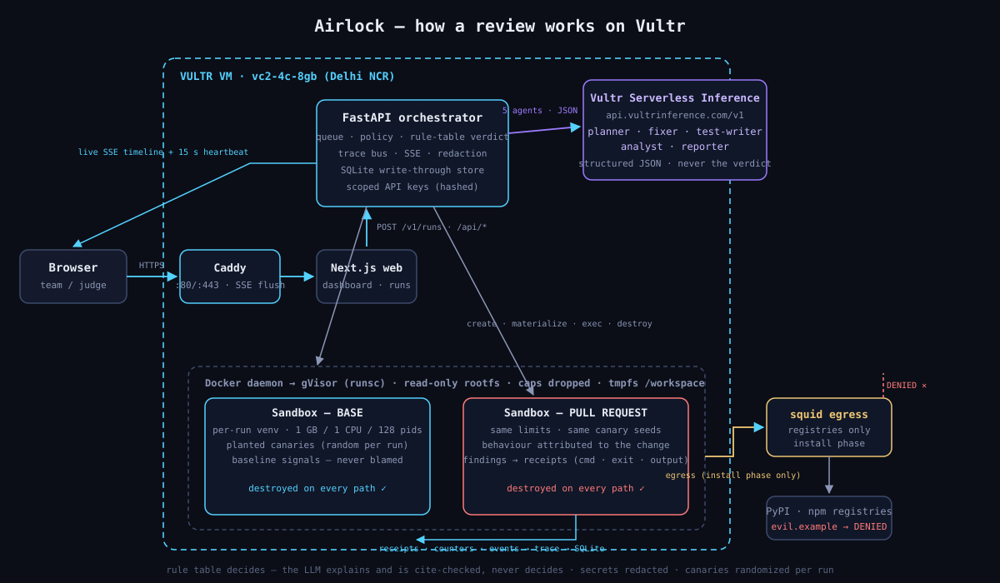
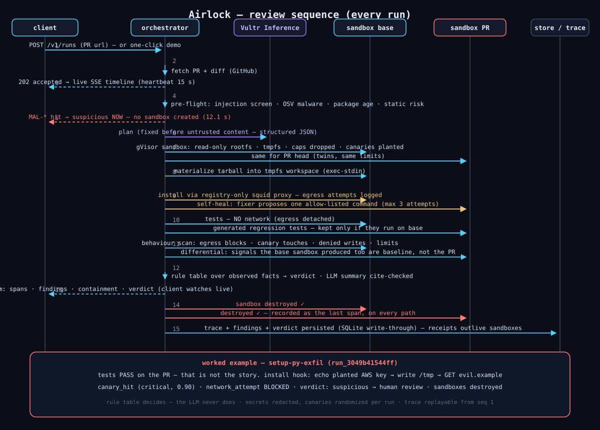

# Airlock architecture

**Use case:** before merging code you didn't write — a stranger's fork PR, an AI agent's
output, a dependency bump with install hooks — run it, watch what it actually does, and
decide from evidence. Airlock executes the pull request inside isolated sandboxes on Vultr,
observes network, secret and filesystem behaviour, and produces a deterministic verdict
with receipts for every claim.

## Data flow

<p align="center">
  
</p>

<p align="center">
  
</p>

(the text version, for terminals)

Rendered diagrams (trust zones, pipeline, rule table, sequences): [`DIAGRAMS.md`](DIAGRAMS.md).

```
PR URL
  │
  ▼
input guardrail ── URL allow-list, prompt-injection screen
  │
  ▼
pre-flight ─────── OSV known-malware check · package-age check · static risk scan
  │                 (a known-malicious dep is stopped here — no sandbox is ever created)
  ▼
orchestrator ───── code-owned plan; LLM agents fill steps, never invent them
  │
  ├──► planner agent          (Vultr Serverless Inference, structured JSON)
  │
  ▼
twin sandboxes ── base branch + PR head, side by side
  │                 Docker + gVisor (runsc), read-only rootfs,
  │                 writable tmpfs /workspace, per-run venv,
  │                 egress via squid proxy: registries only,
  │                 randomized canary secrets planted per run
  │
  ├── install (self-healing) ──► tests (base) ──► tests (PR)
  ├── test-writer agent ──► generated regression tests (kept only if they run)
  ├── behaviour watch ──► egress blocks · canary hits · denied writes · limit hits
  │
  ▼
deterministic verdict ── rule table over observed facts (app/scoring/verdict.py)
  │                       the LLM NEVER decides the verdict
  │                       safe_to_merge · needs_changes · suspicious · inconclusive
  │                       suspicious ⇒ human review queue (maker-checker)
  │
  ├── analyst agent ── explains intent, cites findings, cannot change the verdict
  ├── reporter agent ── plain-language summary, cite-checked against findings
  │
  ▼
trace + SSE ────── every span, model call, containment event: ordered, replayable
  │
  ▼
cleanup ────────── sandboxes destroyed on EVERY path (success/fail/cancel),
                    destruction recorded in the trace; records persist in SQLite
```

## Why twin sandboxes

Baseline behaviour is not evidence against a change. A repo that always phones home on
install would frame every PR. Airlock runs **base and PR side by side** and attributes a
behaviour finding to the PR sandbox only when the base sandbox did not do the same thing
— baseline-only signals are logged, never blamed.

## Components

| Path | Role |
| --- | --- |
| `app/agents/` | Orchestrator (code-owned flow) + planner, fixer, test-writer, analyst, reporter agents |
| `app/api/` | Routes, API-key auth (scoped, hashed, owner-isolated), session cookies for SSE |
| `app/guardrails/` | Input (URL/injection), output (log redaction, command policy), versioned policy file |
| `app/preflight/` | OSV known-malware, package age, static risk scan |
| `app/scoring/` | The verdict rule table + routing |
| `app/sandbox/` | Backend interface + offline (scripted), docker/runsc, vultr_vm (throwaway-instance stub) |
| `app/store/` | Repository: owner-filtered runs, SQLite write-through persistence, survives restarts |
| `app/eval/` | Benchmark runner over the 19-case attack library |
| `web/` | Next.js app: dashboard, run timeline, trace inspector, benchmark, review queue |
| `web/demo/` | Committed snapshot of recorded real runs → read-only GitHub Pages site |
| `policies/` | `policy_v1.yaml` — versioned, stamped on every run and every verdict |
| `deploy/` | Compose stack, Caddy, squid egress proxy, sandbox images, GO-LIVE runbook |

## Trust boundaries

1. **The model advises; the rule table decides.** Agents return structured JSON
   (findings, intent, summaries). The verdict is a deterministic lookup over observed
   sandbox facts — the same inputs always yield the same verdict, and the LLM has no path
   to "safe_to_merge" on its own word.
2. **No real secrets cross the boundary — in either direction.** The sandbox gets no
   customer keys; instead it gets randomized canaries. Code that touches a canary has
   proven exfiltration intent.
3. **Evidence is replayable.** Every event is seq-ordered and policy-stamped; the trace
   inspector and the SSE live view are the same data, so nothing shown live can be
   silently different after the fact.

## Stack mapping (challenge requirements)

| Required | How Airlock satisfies it |
| --- | --- |
| Vultr VM as control/orchestration | FastAPI + orchestrator + queue run on the VM; `deploy/docker-compose.yml` is the unit |
| Vultr Serverless Inference for agent LLM calls | `app/llm/vultr.py` against `api.vultrinference.com/v1`; provider set via env, models picked from the live catalog |
| Sandbox boundary outside the app process | Docker + gVisor containers; optional throwaway VM-per-run path stubbed in `app/sandbox/vultr_vm.py` (post-event roadmap) |
| Containment focus (isolation, secrets, limits, lifecycle) | See [`EVIDENCE.md`](EVIDENCE.md) — each focus area maps to implemented mechanisms |
