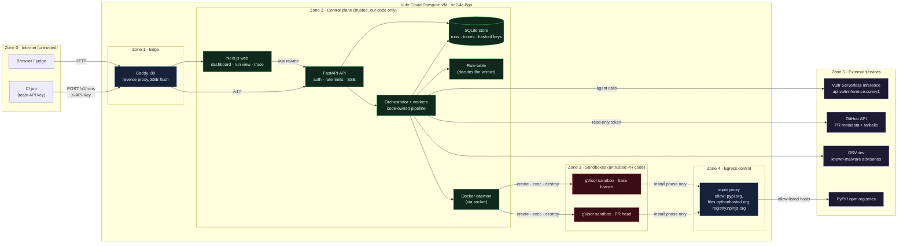
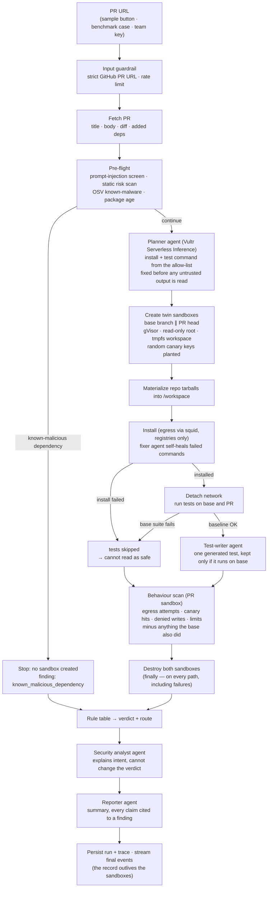
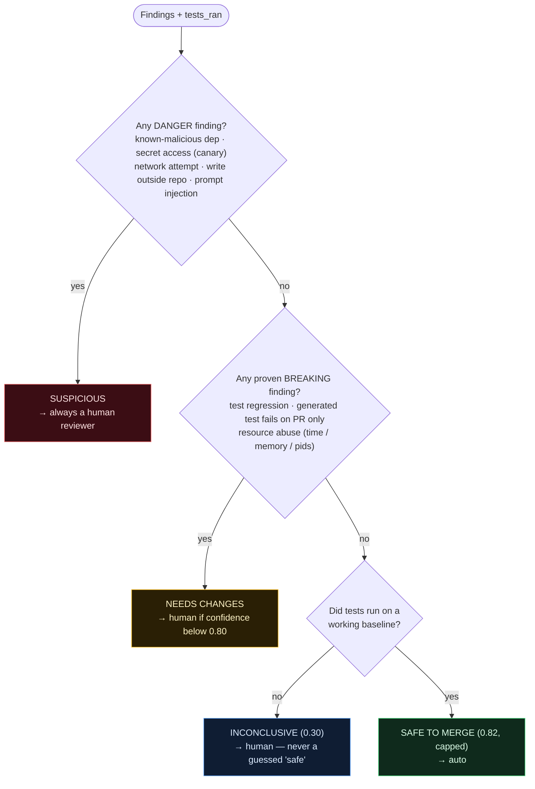
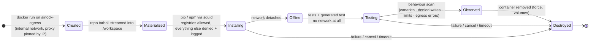
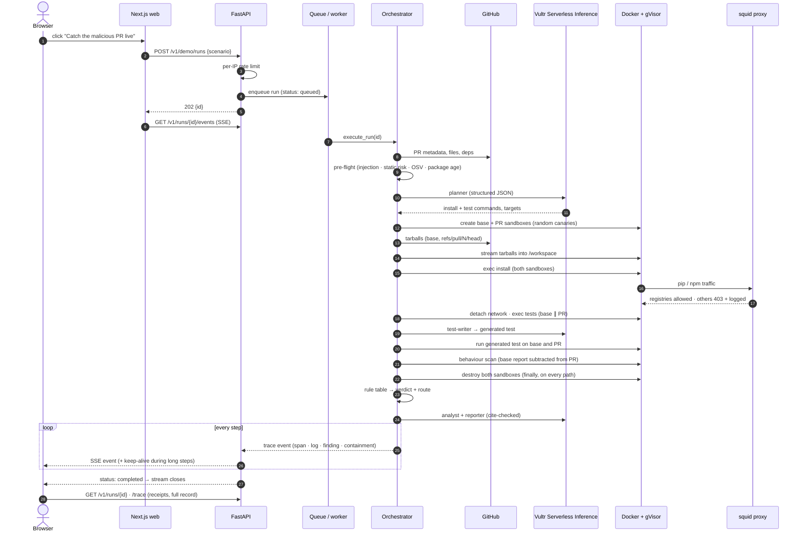
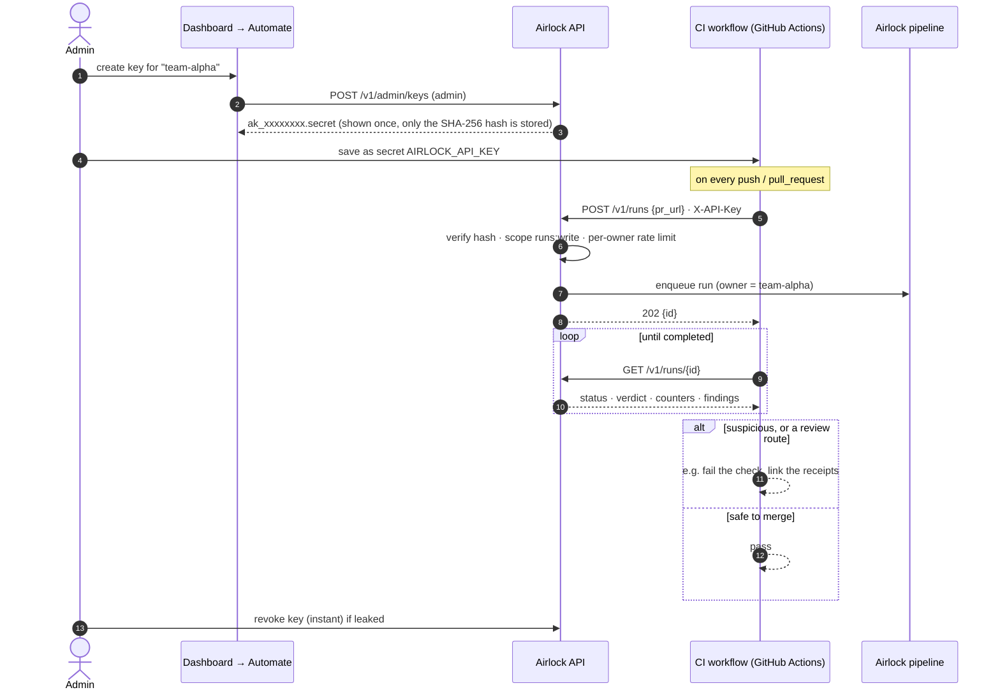
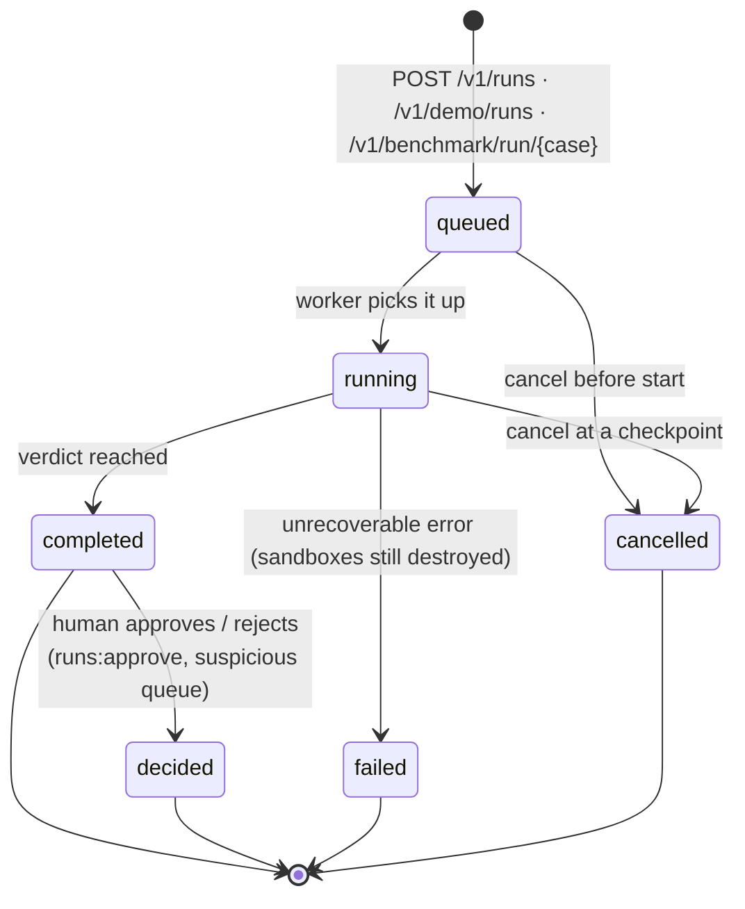

# Airlock diagrams

Zones, flows and sequences for the deployed system, drawn from the code in this repository
(`app/`, `web/`, `deploy/`). GitHub renders every diagram below.

1. [Trust zones](#1-trust-zones) — what can talk to what
2. [Review pipeline](#2-review-pipeline) — one PR from URL to verdict
3. [Verdict rule table](#3-verdict-rule-table) — how evidence becomes a label
4. [Sandbox network phases](#4-sandbox-network-phases) — egress only while installing
5. [Sequence: a live run from the browser](#5-sequence-a-live-run-from-the-browser)
6. [Sequence: CI review with a team key](#6-sequence-ci-review-with-a-team-key)
7. [Run lifecycle](#7-run-lifecycle)

---

## 1. Trust zones

Everything runs on one Vultr VM except the external services. PR code only ever executes
in the **untrusted zone**; the control plane never runs it, and the sandboxes hold no real
credentials.

**Boundary rules**

| From → to | Allowed? | Enforced by |
| --- | --- | --- |
| Internet → control plane | Only through Caddy; API and web bind to `127.0.0.1` | `deploy/docker-compose.yml`, `deploy/Caddyfile` |
| Sandbox → internet | Never directly — the egress network is `internal: true` | `airlock-egress` network |
| Sandbox → registries | Install phase only, through squid's allow-list | `deploy/squid.conf`, `use_network()` |
| Sandbox → anything during tests | No network at all (detached before tests) | `app/sandbox/docker_backend.py` |
| Sandbox → host / app | No: gVisor, read-only rootfs, caps dropped, `no-new-privileges` | `DockerSandbox.create()` |
| Real secrets → sandbox | Never. Only randomized canary keys, fresh per run | `make_canaries()` in `app/sandbox/base.py` |
| LLM → verdict | Never. The model advises; the rule table decides | `app/scoring/verdict.py` |

---

## 2. Review pipeline

Cheap checks first; a sandbox is only created when the PR survives pre-flight. Every box
emits trace events (spans, logs, findings, containment, verdict).

---

## 3. Verdict rule table

First match wins. The confidence comes from the evidence behind the matching findings,
never from the model.

---

## 4. Sandbox network phases

A sandbox only has a route out while dependencies install, and only to the package
registries.

---

## 5. Sequence: a live run from the browser

A sample button on the live site, end to end. The browser watches the run through
Server-Sent Events; the same events form the replayable trace.

---

## 6. Sequence: CI review with a team key

How a team wires Airlock into CI so every push gets the same review.

---

## 7. Run lifecycle

